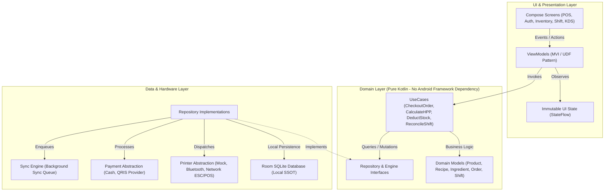

# ARCHITECTURE LOCK SPECIFICATION — DAKOTA POS
**Fase:** 03 — Architecture Lock  
**Status:** LOCKED & VERIFIED  
**Tanggal:** 14 Oktober 2026

---

## 1. Architecture Diagram



---

## 2. Module Responsibilities

| Layer / Package | Tanggung Jawab Utama | Aturan Ketergantungan |
| :--- | :--- | :--- |
| `presentation` | Render UI dengan Jetpack Compose, menangkap input user, visual styling tema kopi, memancarkan event ke ViewModel. | Hanya bergantung ke `domain` dan AndroidX Compose. Tidak boleh mengakses DAO / Room langsung. |
| `domain` | Menjalankan seluruh logika bisnis (kalkulasi HPP, pengurangan stok, permission check, formula kas shift, lifecycle pesanan). | Pure Kotlin. **Dilarang keras** mengimpor library Android UI / Room. |
| `data` | Mengelola Room SQLite database, query DAO, pemetaan entity $\leftrightarrow$ domain model, dan persistensi lokal. | Mengimplementasikan interface dari `domain`. Mengakses Room runtime & SQLite. |
| `core.hardware.printer` | Abstraksi driver printer thermal ESC/POS (Bluetooth, LAN, Mock) terisolasi. | Menerima DTO `PrintReceiptData`, tidak boleh memuat business logic kasir. |
| `core.sync` | Mengelola antrean sinkronisasi background ketika koneksi internet pulih. | Beroperasi secara asynchronous, kegagalan jaringan tidak menghambat POS lokal. |

---

## 3. Data Flow

1. **Kasir Checkout**:
   - Kasir menekan "Bayar" di Compose UI.
   - `PosViewModel` memicu `CheckoutOrderUseCase`.
   - `CheckoutOrderUseCase` memvalidasi izin kasir via `SessionProvider`.
   - Menghitung diskon, subtotal, dan total akhir secara deterministik.
   - Menyimpan transaksi ke Room DB via `OrderRepository`.
2. **Kalkulasi HPP & Pengurangan Stok**:
   - `OrderRepository` memberitahukan status `PAID`.
   - `InventoryDeductionEngine` mengambil resep (`Recipe`) produk yang dibeli.
   - Mengalikan kuantitas resep $\times$ qty produk.
   - Memotong saldo stok bahan baku (`Ingredient`) secara **Idempotent** (menggunakan ID transaksi unik).
3. **Pencetakan Struk & Tiket Barista**:
   - Transaksi yang berstatus `PAID` disiapkan ke dalam format `PrintReceiptData`.
   - Dikirim ke `PrinterInterface`. Jika printer mati / kehabisan kertas, struk masuk ke antrean retry dan transaksi tetap berstatus sah.

---

## 4. Dependency Direction

```
Presentation Layer ──> Domain Layer <── Data Layer
                             ▲
                             │
                  Core Abstractions (Printer, Sync)
```
- **Prinsip Dependency Inversion:** Layer domain mendefinisikan interface/kontrak; layer data dan hardware mengimplementasikannya.
- Modul luar (UI dan Hardware) dapat diganti tanpa merusak satu baris pun logika bisnis di domain layer.

---

## 5. Core Domain Boundaries

1. **Product vs Ingredient:**
   - `Product` adalah menu yang dijual ke pelanggan (contoh: *Es Kopi Susu*).
   - `Ingredient` adalah bahan mentah di gudang (contoh: *Biji Kopi*, *Susu Fresh Milk*, *Gula Aren*, *Cup*).
   - `Recipe` adalah jembatan penghubung: 1 Product memiliki 1 Recipe yang memuat banyak `RecipeItem` (Ingredient + Quantity).
2. **HPP Calculation:**
   $$\text{HPP} = \sum (\text{Recipe Item Qty} \times \text{Ingredient Cost})$$
   HPP bukan angka statis yang diisi manual kasir, melainkan hasil kalkulasi dinamis.
3. **Idempotent Stock Deduction:**
   Pengurangan stok tidak boleh dilakukan saat pesanan baru berupa `DRAFT` atau `CONFIRMED`. Pengurangan HANYA terjadi saat status menjadi `PAID`, dengan proteksi ID transaksi agar tidak terpotong ganda.

---

## 6. Architecture Decision Records (ADRs)

- [ADR-001: Offline-First Architecture dengan Room SQLite](file:///e:/Dakota/docs/architecture/adr/ADR-001-offline-first-room.md)
- [ADR-002: Clean Architecture dan Unidirectional Data Flow (UDF)](file:///e:/Dakota/docs/architecture/adr/ADR-002-clean-architecture-udf.md)
- [ADR-003: Hardware Abstraction Layer untuk Printer dan Pembayaran](file:///e:/Dakota/docs/architecture/adr/ADR-003-hardware-abstractions.md)

---

## 7. Risks

1. **Kapasitas Database Lokal:** Setelah berbulan-bulan beroperasi offline, data transaksi dan log mutasi stok dapat membesar. Diperlukan strategi pengarsipan / pruning transaksi yang sudah tersinkronisasi.
2. **Printer Latency:** Pengiriman data ESC/POS via Bluetooth lambat (bisa 1–3 detik). Pencetakan struk wajib berjalan di latar belakang (Coroutines Dispatchers.IO) agar UI kasir tidak freeze.

---

## 8. OUT_OF_SCOPE Confirmation

Sesuai aturan ketat Master Guardrail:
- Kontrak arsitektur dan abstraksi telah dikunci (*Architecture Lock*).
- **TIDAK ADA** implementasi fitur bisnis Fase 04 (Auth) hingga Fase 13 yang dikerjakan pada fase ini.
- Semua implementasi fungsional tetap menunggu giliran masing-masing fase aktif.
