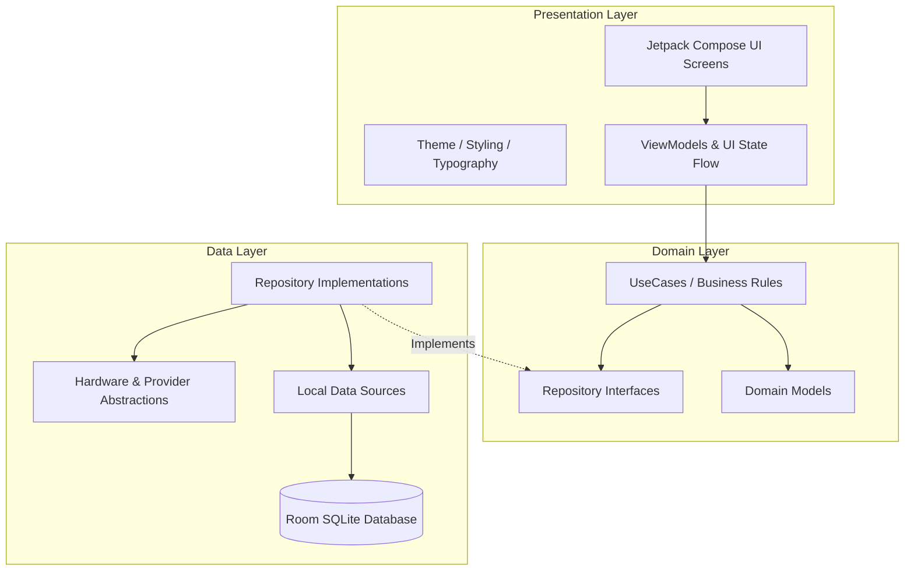

# AUDIT REPOSITORY — DAKOTA POS ANDROID APP
**Fase:** 02 — Repository Audit  
**Status Audit:** COMPLETED  
**Tanggal Audit:** 14 Oktober 2026  
**Target Platform:** Android (minSdk 26, targetSdk 35, Java 21, Kotlin 2.0.21, Jetpack Compose, Room 2.6.1)

---

## 1. Architecture Map

Aplikasi Dakota POS mengadopsi standar **Clean Architecture + Unidirectional Data Flow (UDF)** dengan isolasi layer:



---

## 2. Module Map

Struktur modul dan package dalam codebase saat ini:

```
e:\Dakota\
  ├── gradle/
  │   ├── wrapper/ (Gradle 9.4.1 binary & wrapper properties)
  │   └── libs.versions.toml (Version Catalog tersentralisasi)
  ├── docs/
  │   ├── MASTER_GUARDRAIL.md (Aturan pengawasan AI)
  │   ├── ROADMAP.md (Status pelacakan fase 1-13)
  │   ├── audit/ (Hasil laporan audit)
  │   └── phases/ (Spesifikasi teknis tiap fase)
  └── app/
      ├── build.gradle.kts (AGP 8.8.2, Kotlin 2.0.21, Compose, Room, Coroutines)
      ├── proguard-rules.pro
      └── src/
          ├── main/
          │   ├── AndroidManifest.xml (Permissions: Bluetooth, Network, App declaration)
          │   ├── java/com/dakota/pos/
          │   │   ├── DakotaApp.kt (Application base)
          │   │   ├── MainActivity.kt (Entrypoint launcher Jetpack Compose)
          │   │   ├── core/
          │   │   │   └── database/
          │   │   │       └── Converters.kt (TypeConverters Room LocalDateTime)
          │   │   └── presentation/
          │   │       └── theme/
          │   │           ├── Color.kt (Coffee shop curated palette)
          │   │           ├── Type.kt (Typography scale)
          │   │           └── Theme.kt (Dark/Light mode color schemes)
          │   └── res/
          │       └── values/ (strings.xml, colors.xml, themes.xml)
          └── test/java/com/dakota/pos/
              └── BaseArchitectureTest.kt (Harness unit testing)
```

---

## 3. Feature Map & Klasifikasi Komponen

Berdasarkan audit menyeluruh terhadap 13 area domain Dakota POS:

| Area Komponen | Status Klasifikasi | Catatan Audit |
| :--- | :---: | :--- |
| **Project & Build Harness** | `EXISTING` | Gradle 9.4.1, AGP 8.8.2, Java 21, test runner berfungsi sukses. |
| **Design System & UI Theme** | `EXISTING` | Palette tema kopi, typography, dark/light mode surface terpasang. |
| **Room Database Base** | `PARTIAL` | `Converters.kt` terpasang; Table entities & DAO belum dibuat (sesuai scope bertahap). |
| **Authentication & Role** | `MISSING` | Target pengerjaan Fase 04. |
| **Product + POS Catalog** | `MISSING` | Target pengerjaan Fase 05. |
| **Payment + Receipt** | `MISSING` | Target pengerjaan Fase 06. |
| **Recipe + HPP Engine** | `MISSING` | Target pengerjaan Fase 07. |
| **Inventory Engine** | `MISSING` | Target pengerjaan Fase 08. |
| **Purchasing + Supplier** | `MISSING` | Target pengerjaan Fase 09. |
| **Shift & Cash Management** | `MISSING` | Target pengerjaan Fase 10. |
| **KDS + Barista Printer** | `MISSING` | Target pengerjaan Fase 11. |
| **Finance + Profit Analytics** | `MISSING` | Target pengerjaan Fase 12. |
| **Hardware Abstractions (Printer/QRIS)** | `MISSING` | Interface abstraction akan disiapkan pada Fase 03 & 06. |

---

## 4. Data Flow

Data flow yang telah diverifikasi dan siap digunakan:
1. **Unidirectional UI State Flow**: State di-expose via `StateFlow` dari ViewModel ke `@Composable` screen.
2. **Offline-First Persistence**: Data transaksi kasir, katalog produk, dan pergerakan stok tersimpan lokal langsung di Room DB tanpa memerlukan dependensi server cloud aktif.
3. **Deterministic Business Logic**: Perhitungan total keranjang, diskon, HPP, varians kas shift, dan pergerakan stok dihitung di domain UseCase murni yang dapat diuji dengan Unit Test.

---

## 5. Existing Reusable Components

- [Color.kt](file:///e:/Dakota/app/src/main/java/com/dakota/pos/presentation/theme/Color.kt): Warna primer `CoffeeWarmBrown`, `CoffeeCaramel`, `CoffeeLatte`, status colors (`StatusSuccess`, `StatusWarning`, `StatusError`), serta background dark mode.
- [Theme.kt](file:///e:/Dakota/app/src/main/java/com/dakota/pos/presentation/theme/Theme.kt): `DakotaTheme` terintegrasi dengan Material3.
- [Converters.kt](file:///e:/Dakota/app/src/main/java/com/dakota/pos/core/database/Converters.kt): Konverter timestamp SQLite $\leftrightarrow$ Java `LocalDateTime`.
- [libs.versions.toml](file:///e:/Dakota/gradle/libs.versions.toml): Version catalog tunggal untuk menghindari bentrok versi library.

---

## 6. Technical Debt

1. **Gradle Deprecation Warnings**: Versi Gradle 9.4.1 menampilkan deprecation warning terkait fitur yang akan diubah pada Gradle 10 (tidak menghambat build saat ini).
2. **KSP Room Schema Location**: Perlu dikonfigurasi argumen export schema KSP di `app/build.gradle.kts` agar Room menyimpan schema json untuk validasi migrasi database di masa depan.

---

## 7. Risks

1. **Database Schema Mutation**: Seiring bertambahnya entity dari Fase 4 hingga Fase 12, versi Room DB akan meningkat. Wajib menjaga backward compatibility atau strategi migrasi bersih (*destructive fallback hanya untuk development sebelum production*).
2. **Idempotency Collision**: Pengurangan stok bahan baku saat order paid harus dilindungi dengan ID transaksi unik agar tidak terjadi double-deduction.

---

## 8. Recommended Modification Points

1. **Fase 03 (Architecture Lock)**:
   - Buat kontrak interface abstraksi untuk `ReceiptPrinter`, `PaymentProcessor`, dan `DatabaseContract`.
   - Setup konfigurasi exportSchema Room pada Gradle.
2. **Fase 04 (Authentication & Role)**:
   - Definisikan User entity, Role enum (`Owner`, `Manager`, `Cashier`, `Barista`), dan Session Manager lokal.

---

## 9. OUT_OF_SCOPE Confirmation

Sesuai aturan Master Guardrail:
- **TIDAK ADA** coding fitur bisnis (Auth, POS, Payment, Recipe, Inventory, Shift, KDS, Reporting) yang dilakukan pada fase audit ini.
- Semua pengerjaan tetap terkunci pada scope **Fase 02**.
